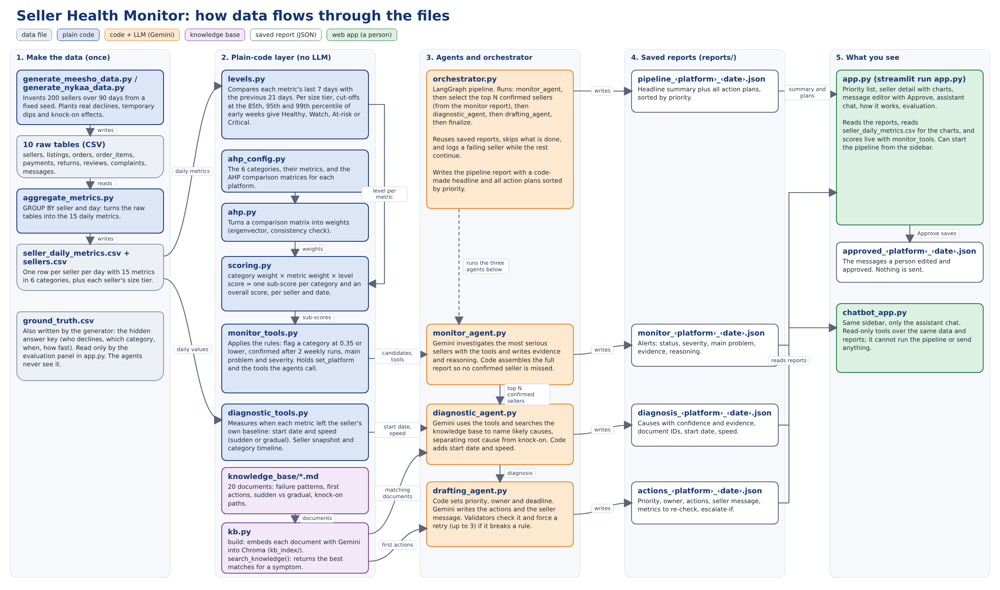

# Seller Health Monitoring Agent

INT450 Large Language Models and Agentic AI, final project (SASTRA Deemed University).

An agent system that watches daily seller metrics on an e-commerce marketplace, finds the sellers who are really declining, explains why, and drafts an action plan and a message for a person to approve. It runs on **synthetic data** for three platforms: **Meesho, Nykaa and Instamart**.

**Design rule:** code applies the rules and does the arithmetic, the LLM investigates and explains, and a person approves. Nothing is ever sent to a seller.



## How it works

```
monitor  ->  select  ->  diagnose  ->  draft  ->  finalize  ->  human approval
```

1. **Score (code).** 15 daily metrics in 6 categories (Marketing, Logistics, Customer experience, Seller support, Finance, Inventory). Each metric's last 7 days are compared with the previous 21 days and given a level (Healthy, Watch, At-risk, Critical) using per-seller-tier cut-offs. Levels are combined into a category score with AHP weights (different for each platform). A category scoring 0.35 or lower is flagged.
2. **Monitor (code + LLM).** The scoring is repeated for 6 weekly dates. A seller flagged in 2 or more weeks is *confirmed*; one week is *watch*. The LLM checks the top candidates with tools and writes notes.
3. **Select (code).** The top 5 confirmed sellers (`--top`) go on to diagnosis.
4. **Diagnose (code + LLM).** Code measures the start date, speed (sudden or gradual) and knock-on categories. The LLM finds likely causes using tools and a knowledge base of 20 documents (RAG).
5. **Draft (code + LLM).** Code sets priority (P1 within 2 days for Critical, P2 within 7 days for At-risk) and the owner team. The LLM writes up to 3 actions and a message of at most 150 words. Pydantic validators check the output and retry up to 3 times.
6. **Approve (person).** The web app lets a person edit and approve. Approving only saves the wording; it does not send anything.

The steps are wired together with LangGraph (`orchestrator.py`). If one seller fails the others continue, saved results are reused, and if the LLM part of monitoring fails it falls back to the rule-based report.

## Project layout

| File or folder | What it does |
|---|---|
| `generate_meesho_data.py`, `generate_nykaa_data.py`, `generate_instamart_data (2).py` | Create the synthetic data for each platform (seeds 42, 11, 23; 200 sellers x 90 days) |
| `meesho_data/`, `nykaa_data/`, `instamart_data/` | The 10 linked tables per platform, plus `ground_truth.csv` (for evaluation only; the agents never read it) |
| `check_data.py`, `aggregate_metrics.py` | Check a platform's tables, then build `seller_daily_metrics.csv` |
| `ahp.py`, `ahp_config.py` | AHP weights and consistency check |
| `levels.py`, `scoring.py` | Metric levels and category scores |
| `monitor_tools.py`, `monitor_agent.py` | Flagging, confirmed vs watch, and the monitoring agent |
| `kb.py`, `knowledge_base/` | Knowledge base of 20 documents and its search (Chroma + gemini-embedding-001) |
| `diagnostic_tools.py`, `diagnostic_agent.py` | Tools and agent that diagnose one seller |
| `drafting_agent.py` | Action plan and seller message, with validators |
| `orchestrator.py` | LangGraph pipeline that runs everything for one date |
| `app.py` | Streamlit web app (priority list, seller detail, assistant, how it works) |
| `chatbot_app.py` | Streamlit page with only the read-only assistant |
| `reports/` | Saved pipeline outputs (JSON) |
| `docs/`, `report/`, `presentation/` | Data-flow diagram, IEEE report and slides |

## Setup

Python 3 with conda (the project used an environment called `seller-health`):

```
conda create -n seller-health python
conda activate seller-health
pip install pandas numpy python-dotenv google-genai pydantic langgraph chromadb streamlit altair
```

There is no `requirements.txt` yet. If an import fails, `pip install` the missing package.

Create a file named `.env` in the project folder with your Gemini API key:

```
GEMINI_API_KEY=your-key-here
```

Never commit `.env`. It is already in `.gitignore`. Each person needs their own key. Check it works with `python test_setup.py`. The model used is `gemini-3.5-flash-lite` (free tier, so it can return "high demand" errors; just rerun).

## Run it

The data is already in the repo. To regenerate a platform, for example Nykaa:

```
python generate_nykaa_data.py
python check_data.py nykaa
python aggregate_metrics.py nykaa
```

Build the knowledge base once (needs the API key):

```
python kb.py build
python kb.py search "late shipments rising"
```

Run the pipeline for one date (use a weekly date such as 2026-09-08; the dates we used are every 7 days from 2026-08-04; add `--platform nykaa` or `--platform instamart`, default is Meesho):

```
python orchestrator.py 2026-09-08                 # full run, top 5 confirmed sellers
python orchestrator.py 2026-09-08 --top 3         # fewer sellers
python orchestrator.py 2026-09-08 --fresh         # ignore saved results
python orchestrator.py --graph                    # print the pipeline as a Mermaid diagram
```

Or run the steps one at a time:

```
python monitor_agent.py 2026-09-08 --rules        # no LLM, rule-based list only
python monitor_agent.py 2026-09-08
python diagnostic_agent.py 2026-09-08 --facts     # no LLM, numbers computed by code
python diagnostic_agent.py 2026-09-08
python drafting_agent.py 2026-09-08 --seller S0065
```

Open the web app (it reads saved reports, so browsing costs nothing; Gemini is only called when you click "Run pipeline", "Rewrite with Gemini" or use the assistant):

```
streamlit run app.py
streamlit run chatbot_app.py      # assistant only
```

## Results (synthetic data, all three platforms)

| | Meesho | Nykaa | Instamart |
|---|---|---|---|
| Confirmed sellers that are truly declining (target 90%) | 89% | 94% | 95% |
| Main problem category right, strict (target 90%) | 95% | 94% | 91% |
| Start date within 7 days (target 80%) | 100% | 89% | 80% |
| Sudden vs gradual right | 94% | 78% | 100% |
| Main problem accuracy of the "lowest-scoring category" baseline | 79% | 76% | 78% |

Start-date and speed figures come from 31 diagnosed sellers (17, 9 and 5), so one seller moves a figure by 6, 11 or 20 points. The same data was used to tune the rules and to test them. About 1 to 2 minutes per diagnosed seller. See the report in `report/` for the definitions and failure cases.

## Limitations

- Synthetic data only. There is no held-out test set.
- A long, slow decline can be absorbed by the 21-day comparison and stop being flagged.
- "Confirmed" needs only 2 flagged weeks, so early dates can produce false alarms.
- One small free-tier model; the LLM can occasionally write thresholds that are not in the diagnosis.

## Team

Team No: [__]. Reethika ([Reg No]), [Name] ([Reg No]), [Name] ([Reg No]). Course faculty: [Name]. Industry mentor: Amit Shah, Delivery Unit Head, MathCo.
